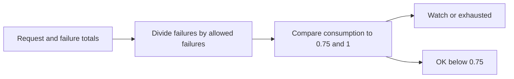

# Inference Error Budget Ledger

Inference error counts have different consequences at different request volumes. Teams need to compare failures against the allowed budget.

## What I built

I built a ledger that divides observed failures by the failure allowance derived from request count and the configured budget percentage. It reports watch at 75% and exhausted at 100% consumption.

## How it works



[Architecture](docs/ARCHITECTURE.md) · [Decision rules and source](docs/RULES.md)

## Tools used

| Tool | Role in this repository |
| --- | --- |
| Python | [budget_ledger.py](budget_ledger.py) implements the CLI and decision rules. Uses `csv` to read tabular exports. |
| Make | Runs the documented example and the local `unittest` suite. |
| Python replay runner | Compares actual stdout with the checked-in baseline fixtures. |
| Ruff and Bandit | Developer lint and static security checks through `make check`. |

## Run the project

Use Python 3.10+ and Make. From the repository root:

```sh
python3 budget_ledger.py sample_budget.csv
```

The rank endpoint consumes 0.6 of its allowance. Classify consumes 1.6 and is exhausted. [Full expected output](examples/Demo%201.stdout.txt)

### Additional replay cases

- **Last sample record in isolation** · `python3 budget_ledger.py examples/last-record.csv` · [Expected output](examples/Last%20sample%20record%20in%20isolation.stdout.txt)

## Verify the project

```sh
make verify
make replay
```

`make replay` checks the recorded cases and exits nonzero if the output changes.
See the [developer guide](docs/DEVELOPMENT.md) for the pinned lint and security tools.

## Operating limits

The fixture uses one supplied window. Verify nonzero request volume and a valid budget before using this signal operationally.

[Case study](docs/CASE_STUDY.md) · [Operator runbook](docs/RUNBOOK.md) · [Verification report](reports/verification.md)
