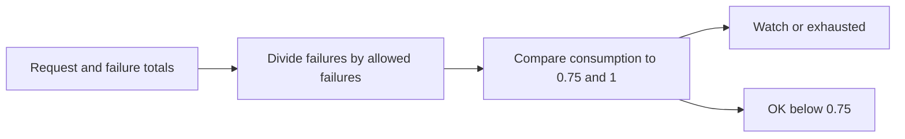

# Inference Error Budget Ledger

Calculates consumed inference error budget from request and failure counts.

Focus: AI/ML platform SLO tracking.

Built as a small, runnable Python project with clear input, output, sample data, and tests.

## Run

```bash
python3 budget_ledger.py sample_budget.csv
```

## Verify

```bash
python3 -m unittest discover . -v
```

## Local verification

Run `make verify` with Make and Python 3 installed. The target runs the documented sample through the project CLI. It also runs the existing Python unit tests.

## Business problem

Inference error counts have different consequences at different request volumes. Teams need to compare failures against the allowed budget.

## Project walkthrough



[Architecture and data flow](docs/ARCHITECTURE.md) · [Business problem, demo, and verification](docs/CASE_STUDY.md)
