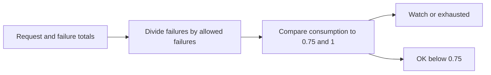

# Inference Error Budget Ledger architecture

Calculates consumed inference error budget from request and failure counts.

## Operational boundaries

The documented run evaluates the bundled sample locally. Results depend on the quality and scope of the input. The demo makes no live infrastructure changes.
